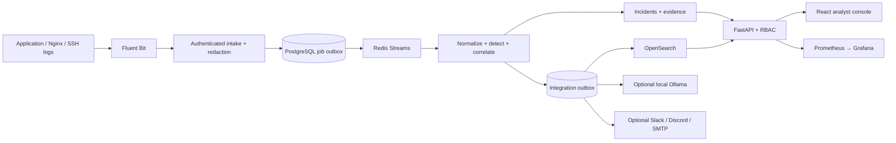
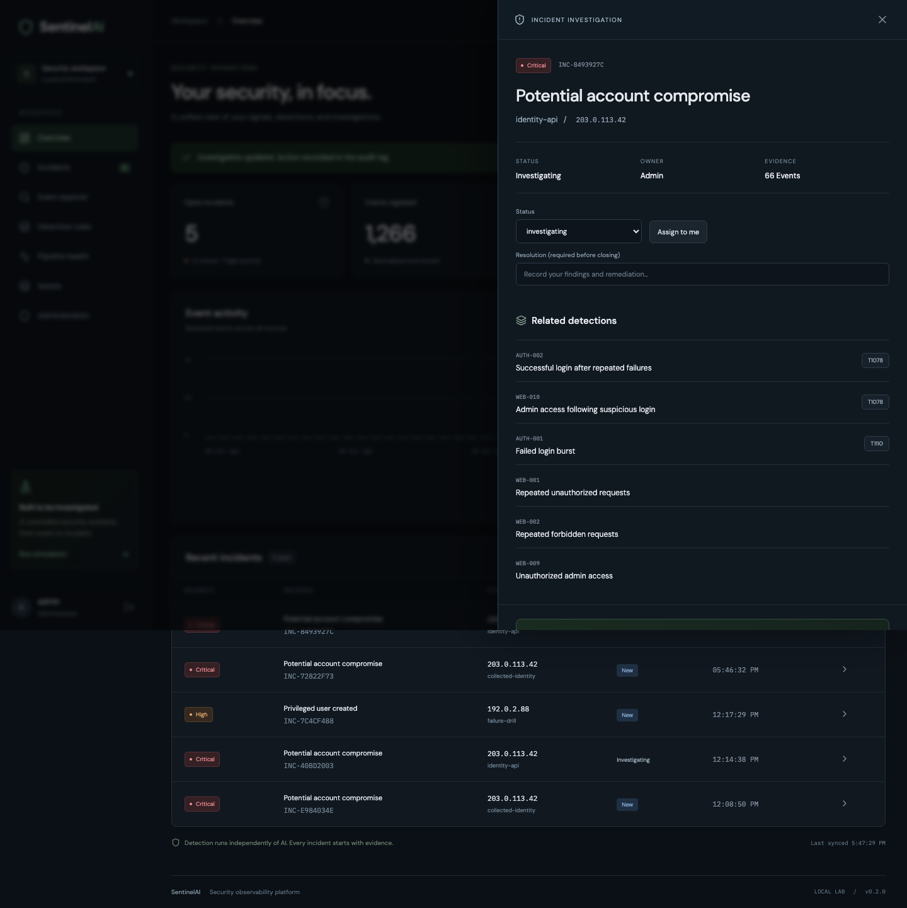

# SentinelAI

**A security observability platform that turns application and host telemetry into explainable incident investigations.**

SentinelAI brings together log collection, deterministic threat detection, alert correlation, incident management, searchable evidence and optional AI assistance. It is built as a hands-on DevSecOps / Cloud Security project: you can run it locally, trace how a suspicious event becomes an incident, test failure recovery, and extend the system through code.

**Current release: v0.2.0.** The full local Docker stack is implemented and tested. AWS infrastructure is supplied as gated Terraform code for `ap-south-2`; it has not been deployed. AI and outbound notifications are disabled by default and can be configured separately.


## Contents

- [What the project does](#what-the-project-does)
- [Features](#features)
- [Architecture and technology stack](#architecture-and-technology-stack)
- [Prerequisites](#prerequisites)
- [Clone and run with Docker](#clone-and-run-with-docker)
- [Run the security demo](#run-the-security-demo)
- [Set up a development environment](#set-up-a-development-environment)
- [Test and verify changes](#test-and-verify-changes)
- [Configuration and integrations](#configuration-and-integrations)
- [Fork, enhance and contribute](#fork-enhance-and-contribute)
- [Repository structure](#repository-structure)
- [Troubleshooting](#troubleshooting)
- [Security boundaries and infrastructure](#security-boundaries-and-infrastructure)
- [Further documentation](#further-documentation)

## What the project does

Individual log lines rarely tell the whole story. A burst of failed logins, a later successful login and access to an administrator endpoint are more useful when investigated together.

SentinelAI follows this workflow:

1. **Collect:** Fluent Bit reads structured application logs and forwards them to authenticated intake.
2. **Normalize:** source-specific records become a common event schema, with sensitive values redacted before persistence.
3. **Queue:** accepted events enter a durable database outbox and Redis Streams.
4. **Detect:** version-controlled rules evaluate patterns, thresholds and authentication sequences.
5. **Correlate:** related alerts become incidents with severity, ownership and an evidence timeline.
6. **Investigate:** analysts search events, inspect MITRE ATT&CK mappings, add notes and record resolutions.
7. **Enrich:** independent workers handle search indexing, optional read-only AI assessments and optional notifications.

Detection continues when an enrichment provider fails. AI is an analyst-assistance layer; it does not execute containment actions.

## Features

| Area | Implemented capabilities |
| --- | --- |
| Log collection | Fluent Bit JSON tailing, persisted offsets, filesystem buffering, authenticated HTTP adapter, stable retry IDs and Docker JSON-wrapper support; host collection example included |
| Secure intake | Collector API key, UTC/IP validation, 16 KiB event limit, 512 KiB request limit, bounded batches and rate limiting |
| Reliable processing | Transactional outbox, Redis consumer groups, pending-message reclaim, broker-loss reconciliation, retry backoff, dead-letter inspection and replay |
| Detection-as-code | 19 Git-managed rules covering authentication bursts/sequences, suspicious web requests, privilege changes, container activity and operational spikes |
| Alert correlation | Rule suppression, entity isolation, incident grouping, severity escalation and asset-criticality context |
| Incident management | Assignment, lifecycle updates, analyst notes, required closing resolution, related alerts, evidence timeline and audit history |
| Event search | OpenSearch indexing, text/time/request-ID filters, labeled database fallback and bounded CSV export |
| Access control | Scrypt password hashes, JWT sessions, rotating refresh tokens, replay-family revocation, logout, account disabling and administrator/analyst/viewer roles |
| Administration | Asset inventory, rule toggles, user creation, audit views and integration-delivery replay |
| Optional AI | Local Ollama adapter with structured output validation, bounded evidence, citation checks, timeout, daily cap and protection against stale results |
| Optional delivery | Slack, Discord and SMTP adapters with durable per-incident/severity jobs, retries and deduplication |
| Observability | Worker heartbeats, protected metrics, Prometheus alert rules and a provisioned Grafana dashboard |
| Data operations | Alembic migrations, original-database upgrades, evidence foreign keys, hourly retention and backup/restore tooling |
| Engineering | Non-root application images, private Compose networks, regression/browser tests, security checks, outage drills and Terraform reference infrastructure |

Live model inference and third-party message delivery were not exercised during verification; those adapters are tested with local doubles. See [integration setup](docs/integrations.md) before enabling them.

## Architecture and technology stack



| Layer | Technology |
| --- | --- |
| Backend | Python, FastAPI, Pydantic, SQLAlchemy, Alembic |
| Frontend | React, TypeScript, Vite |
| Collection and transport | Fluent Bit, Redis Streams, transactional outboxes |
| Persistence | PostgreSQL in Compose; SQLite WAL in native development |
| Search | OpenSearch with explicit mappings and daily indexes |
| Monitoring | Prometheus, Grafana |
| Testing and checks | pytest, Playwright, Ruff, dependency audits, Semgrep, Trivy |
| Packaging and infrastructure | Docker Compose, Nginx, Terraform, GitHub Actions workflow definitions |

Transport is at-least-once. Stable event IDs and atomic database processing prevent duplicated event effects. Detection transactions are serialized for correctness, so adding worker replicas does not provide linear throughput scaling. See [architecture and tradeoffs](docs/architecture.md).

## Prerequisites

Choose either the complete Docker stack or the lighter native development setup.

| Requirement | Docker stack | Native development / host test tools |
| --- | --- | --- |
| Git | Required | Required |
| Docker Engine/Desktop with Compose v2 | Required | Optional |
| Python | Python 3 for secret bootstrap | Python 3.14 recommended; this is the tested development version |
| Node.js and npm | Built inside the frontend image | Node.js 22.14+ and npm; use a compatible current Node version |
| Make | Optional | Used by the supplied development commands |
| AWS account, domain or paid API key | Not required | Not required |

The complete stack needs several GB of available RAM and disk, especially for OpenSearch and container images. The development scripts use POSIX paths and commands; Windows contributors should use WSL2 for this workflow. Local verification was performed on macOS.

## Clone and run with Docker

### 1. Clone the repository

```sh
git clone https://github.com/sukumar9024/Sentinel-AI.git
cd Sentinel-AI
```

If you plan to submit improvements, use the [fork workflow](#fork-enhance-and-contribute) instead.

### 2. Generate local configuration

```sh
python3 scripts/bootstrap.py
```

This creates a private `.env` file containing unique JWT, collector, administrator and database secrets. It preserves an existing file and does not print secret values. Review [.env.example](.env.example) for available settings; do not copy its placeholder passwords into a running environment.

Keep commands in this README at the repository root unless a section says otherwise.

### 3. Build and start the services

```sh
docker compose config --quiet
docker compose up --build -d
```

The first run downloads images and builds the application. Check startup with:

```sh
docker compose ps
docker compose logs --tail=50 api worker integrations collector
```

### 4. Open the application

| Service | Address | Initial credentials |
| --- | --- | --- |
| SentinelAI | http://127.0.0.1:8180 | Username `admin`; `ADMIN_PASSWORD` from your local `.env` |
| Grafana | http://127.0.0.1:3100 | Username `admin`; initially the same generated administrator password |

Grafana includes the **SentinelAI platform health** dashboard. The application may initially show no events or incidents; run the demo below to create evidence.

Only the application and Grafana ports bind to localhost. Database, Redis, search, metrics and worker ports are not published. Native and Docker modes use different databases; data does not automatically transfer between them.

### 5. Stop or restart

```sh
docker compose stop        # Stop services and retain containers/data.
docker compose start      # Start existing containers again.
docker compose down       # Remove containers/networks; retain named data volumes.
```

`docker compose down -v` also deletes the project's named volumes, including its databases, search data and Grafana state. Use it only when you deliberately want a disposable lab reset and have preserved any needed evidence. It is not needed for an ordinary restart or code update.

## Run the security demo

### Quick analyst workflow

1. Sign in and click **Run simulation**.
2. Wait for the worker to process the queued synthetic events.
3. Open **Potential account compromise** in the incident list.
4. Inspect related rules, ATT&CK mappings and the evidence timeline.
5. Assign the incident, mark it Investigating, and add a note.
6. Enter a resolution before marking it Resolved or False Positive.
7. Use Event explorer to search `authentication_success` and expand a normalized record.

### Include the real Fluent Bit collection path

The UI simulation sends events directly to the ingestion outbox. This command instead makes the isolated sample service write logs that Fluent Bit collects:

```sh
docker compose exec -T sample-app python -c "import urllib.request; print(urllib.request.urlopen(urllib.request.Request('http://127.0.0.1:8001/scenario',method='POST')).read().decode())"
```

On a fresh database, the expected flow is:

```text
25 failed logins → successful login → admin access → 6 forbidden requests
33 collected events → 6 deduplicated alerts → 1 critical incident
```

The events are synthetic, and the script does not perform an attack. Repeated runs can merge evidence into an open incident or create additional alert groups after the suppression window. Compare a fresh database with the expected counts rather than expecting every run to reset the dashboard.



## Set up a development environment

For editing Python/TypeScript, running unit tests, or using native mode:

```sh
make setup
```

This creates `.venv`, installs the locked Python dependencies, installs the backend as an editable package, runs `npm ci`, and bootstraps secrets if needed.

Without Make, the equivalent setup is:

```sh
python3 -m venv .venv
.venv/bin/python -m pip install -r requirements.lock
.venv/bin/python -m pip install --no-deps -e .
npm --prefix frontend ci
python3 scripts/bootstrap.py
```

### Start native mode

```sh
make dev
# Equivalent: python3 scripts/dev.py
```

The supervisor starts the API, pipeline worker, integration worker, maintenance worker and Vite frontend.

- Frontend: http://127.0.0.1:5173
- API health: http://127.0.0.1:8000/healthz
- Interactive API documentation: http://127.0.0.1:8000/docs

By default, native mode uses `sentinel.db` and a durable database queue. Search uses the relational fallback unless configured otherwise. It does not start Fluent Bit, OpenSearch, Prometheus or Grafana. Press `Ctrl+C` to stop the supervised processes.

Vite supports frontend hot updates. Restart native services after Python, rule-file or environment changes. In Docker mode, apply source changes with `docker compose up --build -d`; changing the host files alone does not update code already copied into an image.

## Test and verify changes

### Fast local checks

After `make setup`:

```sh
make lint                  # Python lint
make test                  # Rule, correlation, API, auth and operational regressions
make build                 # TypeScript checks and production frontend build
```

The recorded verification includes **68 backend tests and two browser workflows**. Results describe the tested revision and environment; rerun the relevant checks after your changes. Details and limits are in [verification.md](docs/verification.md).

### Browser tests against the Docker stack

Start Compose first, then:

```sh
cd frontend
npx playwright install chromium
E2E_BASE_URL=http://127.0.0.1:8180 npx playwright test
cd ..
```

For native browser testing, run `npx playwright test` from `frontend` without `E2E_BASE_URL`. The Playwright configuration starts or reuses the native development server. Host dependencies from `make setup` and a generated `.env` are required in both cases.

Browser tests create synthetic events, users, assets, notes and audit records in the selected local database. Prefer a disposable development environment. Two simultaneous checkouts need distinct Compose project names and host ports to avoid sharing the same stack.

### Full-stack and resilience checks

With Compose running and host dependencies installed:

```sh
make compose-test
.venv/bin/python scripts/failure_drill.py
make backup-restore
make search-restore
.venv/bin/python scripts/benchmark.py --events 1000
```

| Check | What it verifies |
| --- | --- |
| `compose-test` | Collector-to-search flow, incident correlation, worker restart and duplicate replay |
| `failure_drill.py` | Search fallback, Redis intake rejection, PostgreSQL restart and lost-stream reconciliation |
| `backup-restore` | PostgreSQL dump restored into a separate temporary database, with matching record counts |
| `search-restore` | OpenSearch snapshot restored under temporary index names, preserving the original indexes |
| `benchmark.py` | A bounded local burst and time to relational persistence; not sustained detector capacity |

Run fault drills when nobody else is using the local stack. They temporarily stop this project's services and restore them in cleanup paths. Run restore drills while ingestion is quiet so count comparisons remain meaningful. Private backups are written under ignored `backups/`.

### Security checks and CI

The workflow in [.github/workflows/ci.yml](.github/workflows/ci.yml) defines backend/frontend checks, container integration, browser testing, dependency audits, Semgrep, Trivy and Terraform validation. It contains no automatic cloud deployment job.

Pushes and pull requests can trigger hosted workflows. Check the Actions settings and usage policy of your own fork before enabling runs. This repository's initial publication used `[skip ci]`; hosted workflow success is not claimed in the verification record.

To reproduce dependency checks locally after installing their tools:

```sh
.venv/bin/python -m pip install pip-audit
.venv/bin/pip-audit -r requirements.lock
npm --prefix frontend audit --audit-level=high
```

Record the commands/results in your pull request. A scanner pass is time-specific and does not establish production readiness.

## Configuration and integrations

Review [.env.example](.env.example) and [integration setup](docs/integrations.md). Typical settings include:

| Setting | Purpose / default behavior |
| --- | --- |
| `JWT_SECRET`, `COLLECTOR_KEY`, `ADMIN_PASSWORD` | Generated local authentication secrets |
| `POSTGRES_PASSWORD` | Generated Compose database password |
| `DEMO_ENABLED` | Allows the administrator's synthetic scenario; enabled by local bootstrap |
| `DATABASE_URL` | Native database selection; Compose supplies its private PostgreSQL URL |
| `REDIS_URL` | Optional native Redis transport; supplied automatically in Compose |
| `OPENSEARCH_URL` | Optional native search service; supplied automatically in Compose |
| `AI_ENABLED` | Disabled unless explicitly enabled |
| `OLLAMA_URL`, `OLLAMA_MODEL` | Endpoint/model for a separately installed local Ollama service |
| `NOTIFICATIONS_ENABLED` | Disabled unless explicitly enabled |
| `SLACK_WEBHOOK_URL`, `DISCORD_WEBHOOK_URL`, `SMTP_*` | Optional notification destinations and credentials |
| `EVENT_RETENTION_DAYS`, `JOB_RETENTION_DAYS` | Default retention windows of 30 and 7 days |

Some service URLs are explicitly overridden by Compose's `environment` section. Edit that configuration when changing container-to-container endpoints. Recreate affected containers after configuration changes.

Bootstrap passwords seed new databases. Changing `ADMIN_PASSWORD` later does not reset an existing SentinelAI account or an initialized Grafana database. Use the relevant account-management flow; the SentinelAI administrator API supports password resets and disabling users.

## Fork, enhance and contribute

### 1. Create your fork and feature branch

Use GitHub's **Fork** button on [this repository](https://github.com/sukumar9024/Sentinel-AI), then replace `YOUR_GITHUB_USERNAME` below:

```sh
git clone https://github.com/YOUR_GITHUB_USERNAME/Sentinel-AI.git
cd Sentinel-AI
git remote add upstream https://github.com/sukumar9024/Sentinel-AI.git
git switch -c feature/my-improvement
make setup
```

Your fork is `origin`; the original repository is `upstream`. Before starting another branch, synchronize your local `main` without overwriting its history:

```sh
git fetch upstream
git switch main
git merge --ff-only upstream/main
git switch -c feature/next-improvement
```

If Git cannot fast-forward, inspect the diverging commits and reconcile them deliberately; do not force-push over other contributors' work.

### 2. Choose an extension point

| Change | Start here | Expected verification |
| --- | --- | --- |
| Detection rule | `rules/detections.yaml`, `backend/sentinel/engine.py` | Matching, benign, threshold/window and deduplication cases |
| New log format / event field | `backend/sentinel/schema.py`, `logging/`, `schemas/` | Sanitized parser fixtures, timestamp handling and redaction checks |
| API or access policy | `backend/sentinel/api.py`, `operations.py`, `sessions.py` | Allowed/denied role cases, validation and audit behavior |
| Database schema | `backend/sentinel/models.py`, `migrations/` | Reviewed migration on fresh and existing development databases |
| Analyst UI | `frontend/src/` | TypeScript build and relevant Playwright workflow |
| AI / notification provider | `integrations.py`, `integration_worker.py`, `outbox.py` | Local provider doubles, retry/idempotency, timeout and failure isolation |
| Monitoring or infrastructure | `monitoring/`, `infrastructure/terraform/` | Configuration validation and explicit operational/security tradeoffs |

Practical next improvements include a broader sanitized log corpus, event-time lateness handling, more efficient large-scale detection state, additional analyst filters, application MFA/OIDC and stronger production audit storage. See the [roadmap](docs/roadmap.md).

### 3. Add a detection rule safely

`rules/detections.yaml` currently stores a JSON-compatible YAML list. Add an object to that list, keeping its ID unique. For example:

```json
{
  "id": "WEB-011",
  "name": "Sensitive configuration path probe",
  "severity": "medium",
  "match": {"http_path": {"contains": "/.env"}},
  "count": 1,
  "within_seconds": 60,
  "suppression_seconds": 300,
  "mitre": null,
  "preceded_by": null
}
```

Add the matching fixture to `CASES` in `tests/test_pipeline.py`, alongside any additional positive/negative or boundary cases needed. Review rule-count expectations in browser tests when changing the library. Add an ATT&CK mapping only when the observed behavior supports it.

```sh
.venv/bin/pytest -q tests/test_pipeline.py
```

Rule definitions load at worker startup; restart/rebuild workers after changing the file. Administrator enable/disable toggles are separate database state and apply at runtime.

### 4. Evolve schemas and dependencies deliberately

For an event-schema change, update validation/normalization, parser tests and the generated schema:

```sh
.venv/bin/python - <<'PY'
import json
from pathlib import Path
from sentinel.schema import IncomingEvent
Path("schemas/event.schema.json").write_text(
    json.dumps(IncomingEvent.model_json_schema(), indent=2) + "\n"
)
PY
```

For relational changes, add an Alembic revision against a dedicated development database, review the generated upgrade/downgrade operations, and test preservation of existing evidence. Do not edit an already published migration to change a database that has applied it. Application startup upgrades the selected database, so back up persistent data before testing migrations.

Keep `pyproject.toml`, `requirements.lock` and `requirements.runtime.lock` consistent when changing Python dependencies; the runtime lock excludes development-only tools. Keep `frontend/package-lock.json` updated with frontend dependency changes. Never include environment secrets, database files, backup dumps or Terraform state in a contribution.

### 5. Check, commit and open a pull request

The staging line below illustrates a rule change; replace those paths with the files belonging to your contribution. Review staged files before committing.

```sh
make lint
make test
make build
git status --short
git add rules/detections.yaml tests/test_pipeline.py
git diff --cached --check
git diff --cached --stat
git commit -m "Describe the behavior you changed"
git push -u origin feature/my-improvement
```

Open a pull request from your fork's feature branch into this repository's `main`. Explain the problem, resulting behavior, how you verified it, and any compatibility/security limits. Include screenshots for visible UI changes and migration notes for persistent schema changes. Use synthetic or sanitized evidence, never credentials or customer logs.

## Repository structure

```text
backend/sentinel/           API, schemas, auth, detection and workers
frontend/                  React/TypeScript UI, browser tests and screenshot tooling
rules/                     Version-controlled detection library
schemas/                   Generated event JSON schema
migrations/                Alembic database revisions
logging/                   Fluent Bit configurations and host-input example
monitoring/                Prometheus rules and Grafana provisioning
docker/                    Application images and Nginx configuration
infrastructure/terraform/  Gated AWS reference infrastructure
scripts/                   Bootstrap, development, outage, restore and benchmark tools
tests/                     Backend regression and security tests
docs/                      Architecture, limits, runbooks, verification and screenshots
.github/workflows/         CI workflow definitions
```

## Troubleshooting

| Symptom | What to check |
| --- | --- |
| Missing environment variable / Compose interpolation error | Run `python3 scripts/bootstrap.py` at the repository root; inspect `.env` privately |
| A published port is already in use | Check ports 8180/3100 for Docker and 5173/8000 for native mode; stop the conflicting development service or deliberately change its configuration |
| OpenSearch stays unhealthy | Check Docker memory/disk and `docker compose logs --tail=100 opensearch`; startup may take longer than the API |
| Events accepted but no incident | Check Pipeline health, worker/collector logs, rule thresholds and timestamps; benign events should not alert |
| Search reports `database-fallback` | Inspect OpenSearch and the integrations worker; detection still uses durable relational evidence |
| `503` while Redis is stopped | Shared rate limiting fails intake closed; restart Redis and let accepted work recover |
| Credentials stop working after editing `.env` | Existing account passwords are stored in the database; environment edits do not reset them |
| Screens show extra events/incidents | Simulations, browser tests and benchmarks retain their data; they do not reset the database |
| Native mode shows different data | SQLite and Compose PostgreSQL are separate stores |

Use [operational runbooks](docs/runbooks.md) for recovery, replay, retention, backup and secret-rotation details. Avoid deleting data volumes as a first troubleshooting step.

## Security boundaries and infrastructure

The supplied deployment is a localhost lab. Local OpenSearch disables its security plugin on an isolated network; this configuration is unsuitable for public exposure. Redaction is best effort, AI assessments still require human verification, and there is no automated containment path. Full production limits and the two reviewed infrastructure network findings are documented in [security.md](docs/security.md).

The [Terraform reference](infrastructure/terraform/README.md) targets **`ap-south-2`** and defaults to **`allow_paid_resources=false`** and **`enable_services=false`**. It describes VPC networking, TLS ALB, private ECS/data services, encrypted stores, ECR, secrets, IAM/OIDC, logs and backups.

Local validation, with Terraform installed:

```sh
make infra-check
```

This performs formatting checks, provider initialization without a backend, and schema validation. It does not deploy anything. A future cloud deployment requires an approved budget, real secret/bootstrap setup and the additional gates in the infrastructure documentation. Cloning, testing or contributing to this project does not require AWS authentication or a paid AI service.

## Further documentation

- [Architecture, reliability and detection semantics](docs/architecture.md)
- [Optional AI, notification and collection integrations](docs/integrations.md)
- [Security controls, findings and production limits](docs/security.md)
- [Operational runbooks](docs/runbooks.md)
- [Verification record and measured results](docs/verification.md)
- [Implementation status and roadmap](docs/roadmap.md)
- [Resume bullets and interview walkthrough](docs/portfolio.md)

Additional screenshots: [event search](docs/screenshots/events.png), [rules](docs/screenshots/rules.png), [pipeline health](docs/screenshots/pipeline.png), [assets](docs/screenshots/assets.png), and [Grafana](docs/screenshots/grafana.png).
