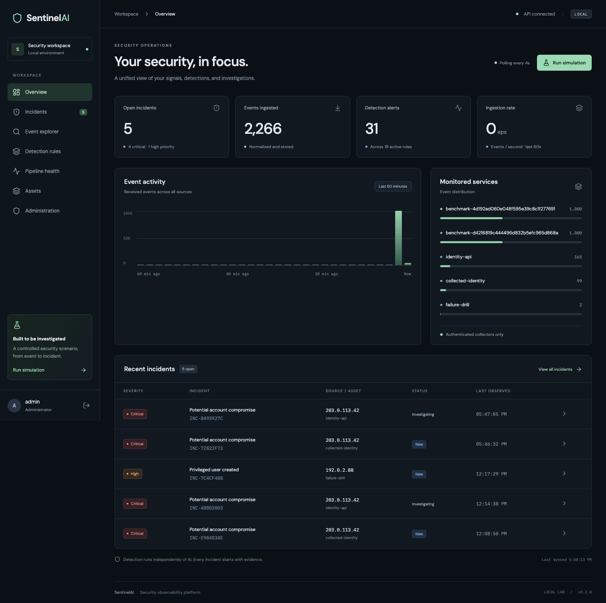
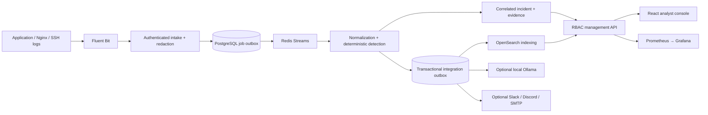

# SentinelAI

**Collect security telemetry, detect suspicious behavior, and investigate correlated evidence.**

A DevSecOps / Cloud Security portfolio application with a working local distributed stack. Deterministic rules create incidents; optional, read-only AI enrichment runs independently. All cloud infrastructure is code only: **no AWS login, plan, apply or paid resources have been used.**



## Start the complete local stack

Requires Docker Compose and several GB of available RAM/disk for OpenSearch and monitoring.

```sh
python3 scripts/bootstrap.py
docker compose up --build -d
```

- **Application:** http://127.0.0.1:8180
- **Grafana:** http://127.0.0.1:3100 — pre-provisioned “SentinelAI platform health” dashboard
- **Login:** `admin`, using `ADMIN_PASSWORD` in the generated `.env`

Bootstrap generates unique secrets with mode 0600, preserves existing values, and never prints credentials. Only application/Grafana ports bind to localhost. PostgreSQL, Redis, OpenSearch, metrics, collectors and workers have no public port mappings. Local OpenSearch intentionally disables its security plugin on the isolated data network; do not reuse this configuration on a public host.

Native mode without Docker remains supported:

```sh
make setup
make dev
# Application: http://127.0.0.1:5173; API/docs: http://127.0.0.1:8000/docs
```

Native mode uses SQLite and a durable database queue. Search falls back to relational evidence. `Ctrl+C` stops the supervised native processes. The initial admin password seeds a new database; later password changes use the admin API and do not synchronize back into `.env`.

## Demonstrate the full collection path

The **Run simulation** button sends synthetic events directly through ingestion. To include the real Fluent Bit collector, generate application log files inside the isolated sample service:

```sh
docker compose exec sample-app python -c "import urllib.request; print(urllib.request.urlopen(urllib.request.Request('http://127.0.0.1:8001/scenario',method='POST')).read().decode())"
```

The sample application writes **25 failed logins → one successful login → admin access → six forbidden requests**. Fluent Bit tails the JSON log with a persisted offset and filesystem buffering, authenticates to the collector adapter, and queues 33 events. The worker produces **six alerts and one critical incident on a fresh database**, while another worker indexes evidence into OpenSearch. No attack traffic is generated.

Open the incident to review evidence and MITRE mappings, assign ownership, add a note, and enter a resolution before closing it. Repeated runs can add evidence to an existing open incident or create additional alert groups after the suppression window.

## Implemented application features

| Area | Capabilities |
| --- | --- |
| Collection | Fluent Bit JSON tailing, persisted offsets, filesystem buffering/retry, authenticated HTTP adapter, stable IDs for replay, Docker JSON-wrapper support and host-input example |
| Ingestion | Collector API key, validated UTC/IP fields, 16 KiB events, 512 KiB requests, durable database outbox, shared Redis rate limits in Compose |
| Processing | Redis Streams groups, pending reclaim, stale-publication reconciliation after broker data loss, retry backoff, dead letters and replay |
| Detection | 19 versioned rules, thresholds/sequences, entity isolation, suppression, correlation, severity escalation, admin rule toggles |
| Investigation | Incident lifecycle, owner, notes, resolution, chronological evidence, ATT&CK links, CSV export and audit history |
| Assets | Asset inventory, environment/service/host ownership and criticality-aware severity |
| Search | Asynchronous OpenSearch indexing, explicit mappings, full-text/time/request-ID filters and labeled database fallback during search outages |
| Access | Scrypt hashes, JWTs, rotating refresh tokens, replay-family revocation, logout revocation, server-enforced admin/analyst/viewer roles, user disable/password reset API |
| Enrichment | Optional local Ollama adapter, structured schema, bounded samples/output, cited event-ID validation, daily request cap, stale-result protection and deterministic fallback |
| Notifications | Disabled-by-default Slack/Discord/SMTP adapters; durable per-incident/severity delivery jobs, retry, deduplication and replay |
| Operations | Alembic upgrades including original v0.1 databases, relational evidence constraints, worker heartbeats, Prometheus alerts and Grafana provisioning |
| Data lifecycle | Hourly retention, incident-linked relational evidence preservation, PostgreSQL backup/isolated restore drill and OpenSearch snapshot/renamed restore drill |
| Delivery | Non-root application images, private data network, CI tests/builds/audits/static scans, local fault-injection and benchmark scripts |

AI and outbound notifications are **off by default**. Their adapters and failure behavior are tested using local test doubles; no real model or third-party message delivery is claimed. See [integration configuration](docs/integrations.md).

## Architecture



Transport is at-least-once; stable event IDs and atomic database processing prevent duplicated evidence. A database lock serializes detection transactions across workers. This favors correctness and failover, **not linear scaling**. Integration HTTP calls occur outside those transactions, so provider failures do not roll back detection. [Detailed semantics and limits](docs/architecture.md).

## Verify locally

```sh
make setup
make lint
make test
make build
make compose-test                    # collector → Redis/PostgreSQL → OpenSearch
.venv/bin/python scripts/failure_drill.py
make backup-restore                  # separate restore database; original untouched
make search-restore                  # renamed restore indexes; original untouched
.venv/bin/python scripts/benchmark.py --events 1000
cd frontend
npx playwright install chromium
E2E_BASE_URL=http://127.0.0.1:8180 npx playwright test
```

The fault drill temporarily stops **only this project's** worker/data services and restores them in `finally` blocks. Run it when no one is using the local lab. Backup drills should run while ingestion is quiet. Browser and load tests add synthetic data and audit records. [Recorded verification](docs/verification.md).

## Infrastructure code, not a cloud deployment

[Terraform](infrastructure/terraform/README.md) defaults to **`ap-south-2`** with `allow_paid_resources=false` and `enable_services=false`. It describes VPC networking, TLS ALB, ECS, encrypted RDS/Redis/OpenSearch, secrets, ECR, IAM/OIDC, logs, backups and optional DNS.

```sh
make infra-check   # fmt + provider initialization without a backend + validate
```

No Terraform plan/apply, AWS authentication or cloud deployment was performed. Hosted CI execution remains unverified. Provisioning remains outside this task's authorization. The blueprint has explicit deployment/security gates and is not a claim of production readiness.

## Repository

- `backend/sentinel/`: API, detection, queues, integration adapters, maintenance, auth
- `frontend/`: React/TypeScript console and browser tests
- `rules/`, `schemas/`, `migrations/`: detection-as-code, event schema, database upgrades
- `logging/`, `monitoring/`, `docker/`: collectors, dashboards, alerts and containers
- `infrastructure/terraform/`: gated AWS reference infrastructure
- `scripts/`, `tests/`: local operational drills, benchmarks and regression tests
- `docs/`: architecture, security, runbooks, integration setup and resume material

[Resume bullets](docs/portfolio.md) · [Security boundaries](docs/security.md) · [Runbooks](docs/runbooks.md) · [Scope and remaining production gates](docs/roadmap.md)
